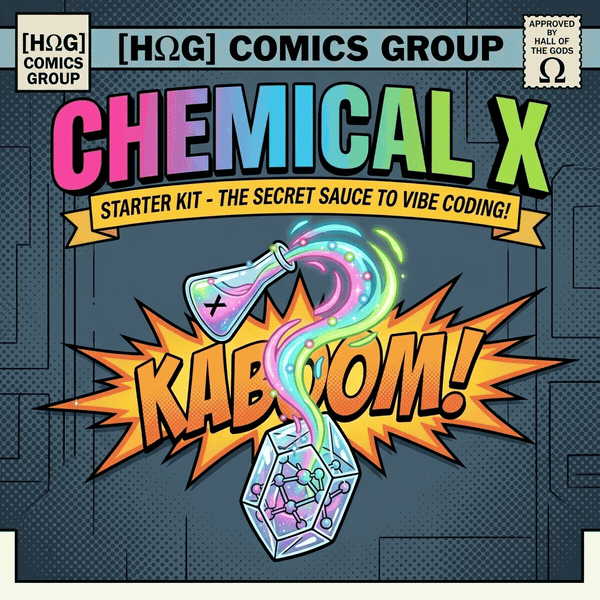

# chemx: the toolkit between AI coding agents and your codebase

<p align="center">
  
</p>

[](https://chemicalx.xophz.com)
[](https://github.com/Chemical-X-Protocol/awesome-secret-sauce)
[](https://github.com/Chemical-X-Protocol/benchmarks)

`chemx` is a command line tool and MCP server. AI coding agents call it instead of raw `cat`, `grep`, `git`, `npm test` and `tsc`, and get short, structured answers back. Several agents can share one checkout without overwriting each other.

> **If you are an AI agent:** jump to [For AI agents](#for-ai-agents). The rules are in [AGENTS.md](AGENTS.md) and the machine-readable index is [llms.txt](llms.txt).

## Why it exists

| Without chemx | With chemx |
| :--- | :--- |
| An agent reads whole files to find one function. | `chemx read file --symbol=name` returns that function. `--outline` returns the shape of the file. |
| `npm test` and `tsc` print every passing line. | `chemx verify` prints one status card, and only the failing lines when something fails. |
| Each agent decides for itself whether its change is good. | One audit rule runs in the editor, the commit hook and the task gate. A change that adds violations to a file fails everywhere. |
| Two agents edit the same file. | File locks and tasks live in a shared SQLite db (`.chemx/index.db`). `chemx commit` refuses a file you do not hold. |
| Duplicate code piles up unnoticed. | `chemx patterns` finds repeated code worth extracting (see [Limitations](#limitations): early stage). |

## Quickstart

```bash
npm install -g chemx          # Node 22.13.0 or later. Or: npx chemx <command>
chemx doctor                  # read-only check of install, PATH, MCP, hooks and index

chemx q "useCardController"                 # find a symbol from the index
chemx read src/card.ts --outline            # the shape of a file, not the whole file
chemx patch src/card.ts --target="oldCode" --replacement="newCode" --dry-run
chemx verify                                # audit + typecheck + tests, one short card
```

Using Claude Code? `chemx install-hooks --host=claude --dry-run` shows what would be written to `.claude/settings.json`. Drop `--dry-run` to apply it. It takes effect in the next session. Using Cursor, VS Code or Antigravity? `npx chemx install-mcp` registers the MCP server (see [MCP server](#mcp-server)).

Starting a new project instead? `npm create chemx my-app -- --framework=vue` scaffolds one (`react`, `vue` or `svelte`).

## What it can do

Run `chemx help` for the live list and `chemx help <command>` for flags and examples. The groups below match that list.

| Group | Commands | What you get |
| :--- | :--- | :--- |
| **Search and read** | `q`, `read`, `trace`, `backtrace`, `check` | AST index search (`--hybrid`, `--blast-radius`, `--inspect`, literal `-g`), reads by outline, symbol or line range, call graphs both ways, a one-file rule check. Every index answer ends with a freshness stamp. |
| **Edit** | `patch`, `write`, `add`, `explode`, `generate` | Exact-text patches and whole-file writes that check the result parses, report new audit violations (`introducedViolations`) and re-index. `add` adds a prop, state or action to a capsule. `explode` splits a large file. `generate` scaffolds a capsule. |
| **Verify** | `verify`, `test`, `typecheck`, `lint`, `build`, `audit`, `trend`, `badge`, `docs` | Failures only. `verify` is audit + typecheck + tests. `audit` grades the code against the 7 pillars. `trend` shows score history, `badge` writes an SVG, `docs` checks that chemx commands named in docs exist. |
| **Refactor** | `patterns`, `blueprint`, `heal` | Find repeated code, plan one extraction, apply it and roll back if any check fails. In development. |
| **Git and shell wrappers** | `d`, `show`, `status`, `log`, `conflicts`, `commit`, `ci`, `wait`, `p`, `f`, `j`, `do` | Token-bounded diff, log and `package.json`, file finder, JSON shape, path-limited lease-checked commits, a PR's checks, and batching several commands in one process. |
| **Agents and swarm** | `team`, `run`, `project`, `scratch`, `worktree`, `mutate`, `report`, `friction` | Tasks, file locks, DMs and a feed. Model routing per task tier and a rendered Claude Code Workflow for build, review, repair and gate. Per-agent scratch dirs and worktrees. Cost reports. A log of guard denials. |
| **Setup** | `init`, `create`, `pillars`, `install-mcp`, `hook`, `doctor`, `ui`, `tesseract` | Unpack blueprints, scaffold apps, configure rules, install MCP and hooks, diagnose problems, a local web dashboard, and the agent onboarding briefing. |

The shape of the output matters as much as the list. These are real results:

```
$ chemx verify
  ✔ AST Architecture:  A+ (100/100, 0 violations)
  ✔ TypeScript:        Clean (0 errors)
  ✔ Test Suite:        Passed (143/143)

$ chemx typecheck --json     # one minified line when it fails
{"success":false,"exitCode":2,"errorCount":1,"errors":["src/a.ts:1:7 TS2322 Type 'string' is not assignable to type 'number'."]}
```

## How it works

```
 agent / human ──► chemx CLI or MCP tool
                        │
        ┌───────────────┼────────────────┐
        ▼               ▼                ▼
   AST index        audit rules     team tables
   (symbols,        (7 pillars,     (tasks, locks,
   imports,          one gate        feed, token
   call graph)       rule)           costs)
        └───────────────┴────────────────┘
                 .chemx/index.db  (SQLite, one per monorepo)
```

- **One gate rule.** The pre-commit hook, `chemx verify`, `chemx team task done` and `patch`/`write` all fail a change when any rule's violation count rises in a file. A commit one accepts cannot turn another red. See [docs/audit-gates.md](docs/audit-gates.md).
- **Locks are leases.** They renew while an agent uses chemx and stop renewing after a cap when others wait. See [docs/team-locks.md](docs/team-locks.md).
- **chemx renders and checks; the host runs agents.** `chemx team dispatch --workflow` writes a script. Claude Code's Workflow tool runs it. `chemx team audit-run` checks the result afterwards.

## For AI agents

- **Read first:** [AGENTS.md](AGENTS.md) is the canonical rulebook (thresholds, pillars, coordination protocol). `CLAUDE.md` and `GEMINI.md` are generated pointers to it. Regenerate with `chemx pillars --write`, do not hand-edit.
- **Onboarding briefing:** `chemx tesseract` prints project metrics, the 7 directives and the commands to start with.
- **One MCP tool:** `chemx({ action, params })`. `{ "action": "help" }` lists every action. Mutating actions (`write`, `patch`, `autofix`, `generate`, team claims and posts) need `params.projectRoot` set to the absolute repo path.
- **Default loop:** `chemx q` to find, `chemx read --outline` or `--symbol` to look, `chemx patch` to edit, `chemx test --changed --depth=3` while working, `chemx verify` before you finish.
- **Shared workspace:** claim a task, lock each file, commit small with `chemx commit`, release locks, then `chemx team task done`. Details in [docs/coordination-db.md](docs/coordination-db.md) and [docs/team-locks.md](docs/team-locks.md).
- **Guard hooks:** in Claude Code, hooks steer raw shell tools toward chemx and can block the native file tools. To bypass one, append `# chemx-bypass: <reason>`. The bypass is logged as friction. See [docs/hooks.md](docs/hooks.md).

### MCP server

`npx chemx install-mcp` merges a `chemical-x` entry into `.cursor/mcp.json` and `.vscode/mcp.json` (add `--global` for Antigravity). Existing servers are kept and the old file is saved as `.bak`. Manual config for any MCP client:

```json
{ "mcpServers": { "chemical-x": { "command": "npx", "args": ["-y", "chemx", "mcp"] } } }
```

Three call forms: `{ "action": "read", "projectRoot": "/abs/repo", "params": { "path": "src/a.ts", "outline": true } }`, a CLI string `{ "command": "q useBrandingStore --blast-radius" }`, or a batch `{ "commands": ["d", "p -s", "verify"] }`. The full contract (root resolution, write refusal, shell limits, stale-server notice) is in [docs/reference.md](docs/reference.md#the-chemx-mcp-tool).

## The 7 architecture pillars

The audit enforces these. `chemx pillars` turns them on or off per project.

1. **Molecular line budgets.** Single-purpose files; soft warning at 250 lines when complexity is high, flagged above 500.
2. **Zero raw DOM.** Raw HTML only inside atoms (`a-*`); molecules compose atoms.
3. **Table-of-contents views.** A top-level view is a 10 to 20 line composition.
4. **Composable contracts.** Composables return plain objects of refs, computeds and functions, and clean up after themselves.
5. **Silent verification.** Verify through `chemx verify`, `test` and `typecheck`, which print failures only.
6. **AST query engine.** Search and read through the index, never by dumping files.
7. **Swarm backlog.** Tasks, leases and costs live in SQLite, not in markdown files.

The audit also catches AI-slop text ("Here is the code", `// ... rest of implementation`), mock data and fake emails, leaked secrets, swallowed catches, and tests that assert nothing. Rule-by-rule detail is in [docs/reference.md](docs/reference.md#two-tier-decoupled-audit-pipeline).

## Languages

| Language | Depth |
| :--- | :--- |
| TypeScript, JavaScript, Vue, Svelte | Full AST audit (Babel and `@vue/compiler-sfc`), hook contracts, template clone detection |
| PHP and WordPress | AST audit plus WordPress rules (REST permissions, nonces, opt-in SQL, input, output). See [docs/php-wordpress.md](docs/php-wordpress.md) |
| C# | Structural patterns: line budgets, empty catches, in-memory stubs |
| Python, Go, Rust | Text passes only: line budgets, slop, mock data, secrets, tautological assertions, symbol indexing |

Any other file type is not audited. A broader language adapter layer (`cli/lang/`, with `.chemxrc` `languages` config and a `CHEMX_LANG_ENGINE=legacy` kill switch) is being rolled out in stages. With no config you get the table above.

## Limitations

- **Forge is not finished.** `patterns --forge` recall is 65% on its labeled set against a 70% target. `blueprint` plans and edits nothing. `heal` works only for groups matched to a library piece, and has healed one group so far.
- **npm lags main.** The `chemx` on npm can be behind this repository. `chemx --version` tells you which build you have.
- **Reconnect MCP after upgrading.** A running server keeps the code it loaded, reports `stale chemx MCP server` and runs each call in a slower fresh process until you reconnect (`/mcp` in Claude Code).
- **Hooks are advice with limits.** The guard reads command text. It does not sandbox a script that writes files itself.
- **Dispatch proves little by itself.** chemx renders the script and checks the run afterwards. It cannot show that an agent did its task.
- **Short flags are not validated.** A mistyped `-x` is not caught.

## Measured results

Each figure is one recorded run, not a benchmark suite, and none predicts your project.

| Result | Date | Source |
| :--- | :--- | :--- |
| Reading by outline or symbol instead of the whole file saved 25% to 97% per target, 75% in aggregate (10 targets) | 2026-10-09 | `pnpm bench`, [benchmarks/README.md](benchmarks/README.md) |
| One dispatch run: 11 tasks, 29 agents, $5.65 against $8.51 priced at Opus, 0 lease lapses, 85.8% of tool calls through chemx | 2026-10-09 | `chemx team audit-run --run=wf_afacbbe8-24c`, feed #7240 and #7241 |
| Ledger of 10,053 tool calls: 6.13M characters returned against 37.92M for the native counterfactual (83.8% fewer) | 2026-10-09 | `tool_calls` table in `.chemx/index.db` |

The full table, with methods and reproduction steps, is in [docs/reference.md](docs/reference.md#measured-results).

## Documentation map

| Need | Go to |
| :--- | :--- |
| Every command with flags and examples | `chemx help <command>`, [docs/reference.md](docs/reference.md) |
| All reference pages | [docs/INDEX.md](docs/INDEX.md) |
| What changed | [docs/CHANGELOG.md](docs/CHANGELOG.md) |
| Rules and thresholds | [AGENTS.md](AGENTS.md), [STANDARDS.md](STANDARDS.md) |
| Dispatching a swarm | [docs/team-dispatch.md](docs/team-dispatch.md), [docs/team-audit-run.md](docs/team-audit-run.md) |
| Search and read details | [docs/search.md](docs/search.md), [docs/index-freshness.md](docs/index-freshness.md) |
| Test lanes | [docs/test-lanes.md](docs/test-lanes.md) |
| Something broken | `chemx doctor`, [docs/doctor.md](docs/doctor.md) |

## Privacy

Audit, verify, search, read, patch, generate and team commands send nothing over the network. Only four explicit flows do: a license download (`init` or `create` with a key), a license fallback check, `audit --share` and error reports with `--post-issue`. Share and error reports print their full content first. `CHEMX_OFFLINE=1` or `DO_NOT_TRACK=1` disables all of them. Hosts, stored files and masking rules are in [docs/reference.md](docs/reference.md#privacy--network).

## Versioning and license

Versions are minute-precision CalVer (`YY.MM.DD-MMMM`), bumped by CI. `create-chemx` and `chemx` publish together.

Core CLI tools and capsule generators are MIT licensed. Private production monorepos and extended starter suites are unlocked for verified GitHub Sponsors. See [chemicalx.xophz.com](https://chemicalx.xophz.com).
